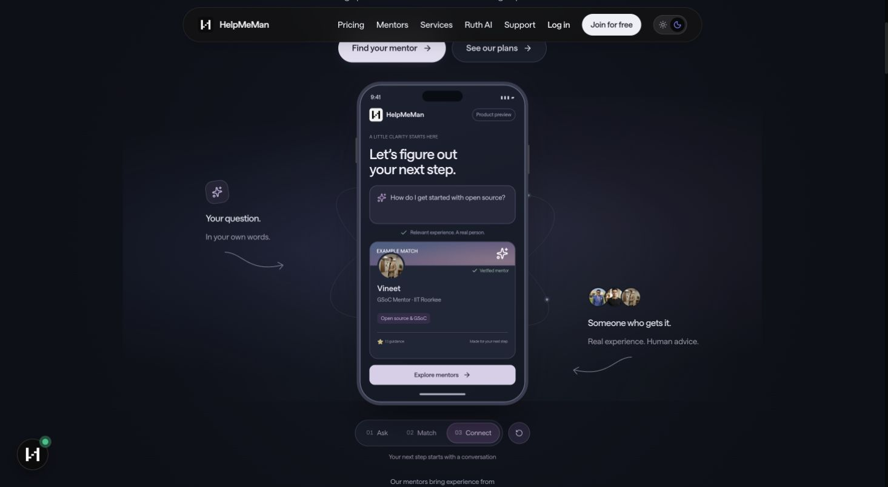
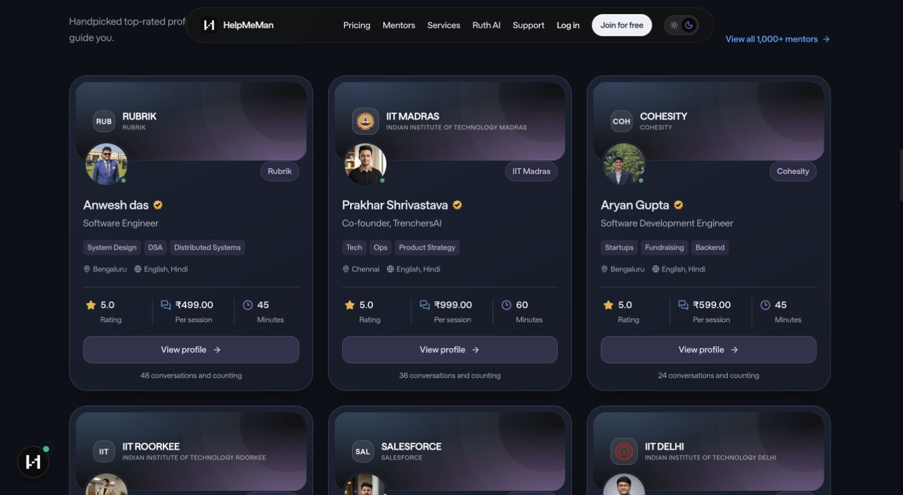

# Public UI and typography

The landing page now pairs a phone preview with calm, finite explanatory motion. It restores the earlier unboxed annotations, overlapping mentor avatars and curved arrows. Three.js renders thin stationary elliptical tracks and three slowly moving points at the browser frame cadence. Explicit pause, reading focus, visibility, viewport and reduced-motion handling bound its lifecycle.

A single locally hosted variable font supplies the real300–900 weight range. This avoids the legacy static asset named Bold (internally weight900) being registered as700/800. Public sections share heading/body roles; card metadata, pricing and footer text are larger and use normal body tracking. Dark theme persistence follows the pre-paint preference rather than resetting on mount.

The request composer uses a colored stroke and downward-offset shadows. Mentor cards use inset banners, overlapping portraits, readable rating/price/duration and a clear profile action. Trust statistics and the institution wall stay still and readable. Pricing links lead to the existing mentor directory.

Base UI supplies public navigation, authentication, confirmation and profile-photo dialog focus/dismissal behavior. Existing authentication handlers and real destinations are preserved. This does not include the separate onboarding-routing changes.

## Visual evidence

Screenshots show the reviewed local visual state. Live auth/2FA submission, backend booking/matching and physical-device smoothness are outside this visual verification.
